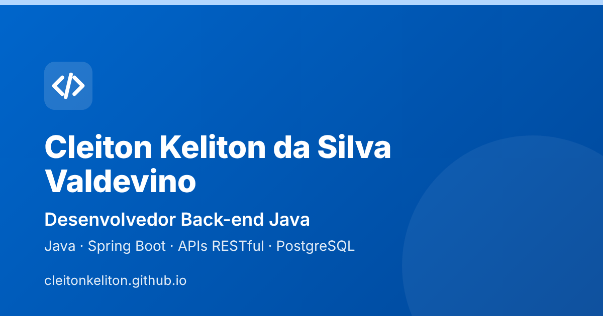

# Portfólio — Cleiton Keliton

Site pessoal com apresentação, habilidades, projetos e currículo.

**🔗 https://cleitonkeliton.github.io**



## O que tem no site

- Apresentação, "Sobre mim", habilidades e projetos com link para o código
- Currículo em PDF para visualizar ou baixar
- Formulário de contato enviado pelo [Formspree](https://formspree.io)
- Tema claro e escuro: segue o sistema operacional até o visitante escolher, e a escolha fica salva
- Layout responsivo, do celular ao desktop

## Detalhes técnicos

- HTML, CSS e JavaScript puros: sem frameworks, sem etapa de build e sem bibliotecas ou CDNs de terceiros
- Acessibilidade: contraste WCAG AA nos dois temas, navegação por teclado (inclusive no menu mobile), zoom liberado e marcação semântica
- O conteúdo continua visível sem JavaScript, e o formulário também envia sem ele (direto pelo Formspree)
- O tema é aplicado antes da primeira renderização, sem "piscar" o tema errado
- Animação de entrada das seções com `IntersectionObserver`, respeitando `prefers-reduced-motion`
- Prévia de compartilhamento (Open Graph) e favicon

## Estrutura

| Arquivo | Função |
| --- | --- |
| `index.html` | Conteúdo da página |
| `style.css` | Estilos, temas claro/escuro e responsividade |
| `script.js` | Tema, menu mobile, animações e envio do formulário |
| `curriculo-cleiton-keliton.pdf` | Currículo |
| `favicon.svg`, `favicon.ico`, `apple-touch-icon.png` | Ícones do site |
| `og-image.png` | Imagem exibida ao compartilhar o link |

## Como rodar localmente

Não há dependências. Na pasta do projeto:

```bash
python3 -m http.server 8000
```

Depois abra http://localhost:8000 no navegador.

## Publicação

O GitHub Pages publica automaticamente o conteúdo da branch `main`.

## Créditos

Ícones das tecnologias: [Font Awesome Free](https://fontawesome.com) (licença CC BY 4.0).
